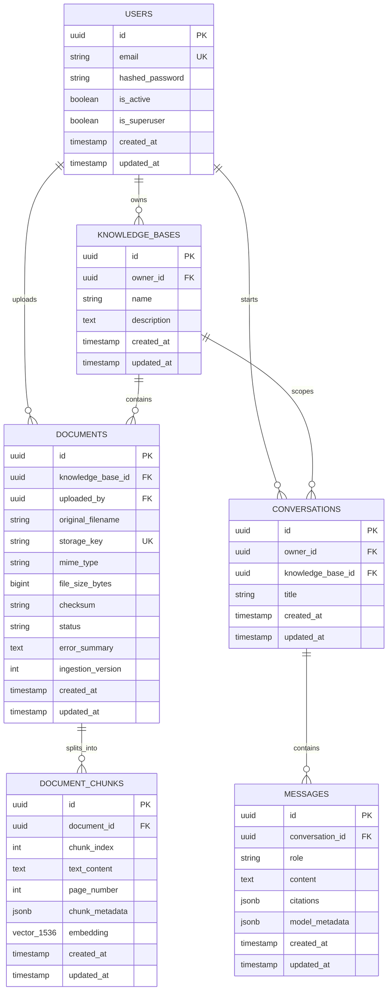

# MedRAG Database Design & Schema Specification

This document details the relational schema, entity relationships, indexing strategy, and vector storage design for MedRAG.

---

## 1. Entity-Relationship Diagram (ERD)



---

## 2. Table Specifications & Indexing Strategy

### `users`
- **Primary Key**: `id` (UUIDv4)
- **Indexes**:
  - `ix_users_email` (UNIQUE): Fast $O(\log N)$ lookup during login and registration.

### `knowledge_bases`
- **Primary Key**: `id` (UUIDv4)
- **Foreign Keys**:
  - `owner_id` $\rightarrow$ `users(id)` (`ON DELETE CASCADE`): When an account is removed, its knowledge bases are purged.
- **Indexes**:
  - `ix_knowledge_bases_owner_id`: Essential for filtering all knowledge bases belonging to the authenticated user (`WHERE owner_id = :current_user_id`).

### `documents`
- **Primary Key**: `id` (UUIDv4)
- **Foreign Keys**:
  - `knowledge_base_id` $\rightarrow$ `knowledge_bases(id)` (`ON DELETE CASCADE`).
  - `uploaded_by` $\rightarrow$ `users(id)` (`ON DELETE SET NULL`): If an uploader's user account is deactivated, the organizational document remains accessible.
- **Indexes**:
  - `ix_documents_knowledge_base_id`: Fast retrieval of all files within a knowledge base.
  - `ix_documents_status`: For background workers to poll pending or processing jobs (`WHERE status = 'uploaded'`).
  - `storage_key` (UNIQUE): Guarantees no two records collide on the physical file identifier.

### `document_chunks`
- **Primary Key**: `id` (UUIDv4)
- **Foreign Keys**:
  - `document_id` $\rightarrow$ `documents(id)` (`ON DELETE CASCADE`): Deleting a document instantly and transactionally cleans up all of its chunks and embeddings.
- **Indexes**:
  - `ix_document_chunks_document_id`: For fetching all chunks belonging to a document.
  - Vector similarity index (`HNSW` / `IVFFlat` on `embedding` using cosine distance `<=>`).

---

## 3. How PostgreSQL and pgvector Work Together

In pure vector databases (e.g. Pinecone), vector data is stored separately from relational data, leading to **dual-write synchronization bugs** and awkward authorization filtering.

In MedRAG with `pgvector`:
- Every vector embedding lives directly in the `document_chunks` table alongside the `text_content` and `page_number`.
- Vector similarity search and relational authorization execute in **a single query**:

```sql
SELECT 
    c.id,
    c.text_content,
    c.page_number,
    1 - (c.embedding <=> :query_embedding) AS similarity_score
FROM document_chunks c
JOIN documents d ON c.document_id = d.id
WHERE d.knowledge_base_id = :target_kb_id
ORDER BY c.embedding <=> :query_embedding
LIMIT 4;
```

### Supported Distance Operators:
- `<=>` : **Cosine Distance** ($1 - \text{cosine similarity}$). Best for normalized semantic embeddings.
- `<->` : **Euclidean Distance** ($L_2$ distance).
- `<#>` : **Negative Inner Product**.
